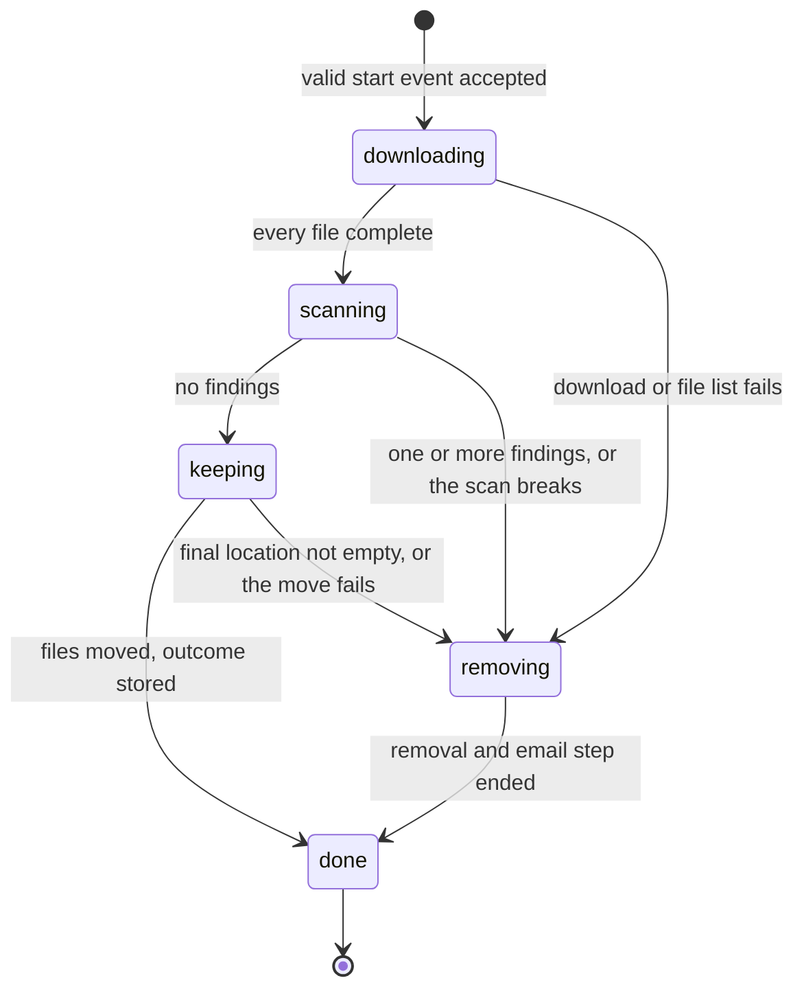
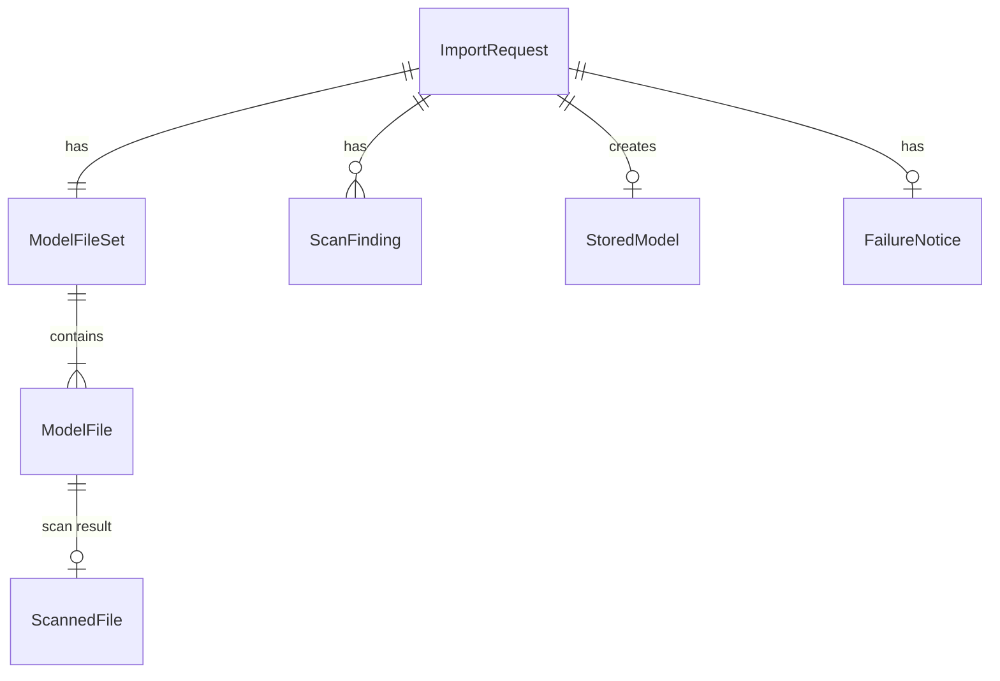

# Functional Spec: u1-import-slice

This is the behaviour of the thin end-to-end slice, the first Bolt (one pass of building that ends in something that runs). It covers the stories (`stories.md`) US1.1 (AC1.1.1), US2.1 (AC2.1.1 to AC2.1.3), US3.1 (all), US4.1 (AC4.1.1 and AC4.1.3), US5.1 (AC5.1.1), and US5.2 (AC5.2.1 and AC5.2.2), as split in `unit-of-work-story-map.md`. The rules are in `rules.md` and the data in `entities.md`. This file is the source of truth for the order of steps and the lifecycle of an import. The ER diagram and the rules summary below are derived views.

## Workflow: One Import

The ImportCoordinator runs the steps in order and waits for each one (ADR-002 in `components.md`).

1. A start event arrives with the model name, the exact version, and the sender's email address (contract C1). The ImportCoordinator checks the three fields (BR1.1, BR1.3). If a field fails, nothing starts and one log line names the field without its value. Otherwise it creates the ImportRequest with status `downloading` (BR1.2).
2. **Download.** ModelDownloader lists the files of the exact version with their sizes and checks the list: it must not be empty, must hold at least one `.safetensors` file, and every path must be safe and unique (BR1.3, BR2.6). It then downloads each file into `holding/<importId>/`, with no account or token (BR2.1, BR2.2).
   - A temporary problem on a file is retried from the start of that file, up to 3 times for that file (BR2.4).
   - A permanent problem fails the import at once (BR2.3).
   - A file is complete only when its received size equals the size in the listing (BR2.5).
   - When every file is complete, status becomes `scanning`.
3. **Scan.** LeakScanner classes every file by the last part of its path (BR3.1) and checks all of them:
   - `weight` files: only the header is read (BR3.2).
   - `disallowed-weight` files: a finding.
   - `scanned-text` files: read as text in parts and scanned for the kinds of data in BR3.3; an unreadable file is a finding (BR3.4).
   - `ignored` files: not read and not checked.
   - All findings are collected, each with file, place, and kind and never the value; at most 100 are recorded per file (BR3.5, BR3.6, BR3.7). A break of the scan itself is a failed step.
4. **Decision.** If there is no finding, status becomes `keeping`. If there is one or more finding, or the scan broke, the import is stopped (step 6).
5. **Keep.** FileCustodian first checks that the final location for this model and version is empty, then copies every file to `models/<modelName in lowercase>/<exactVersion>/`, creates the StoredModel, and removes the holding area. The ImportCoordinator sets the outcome `stored` and status `done`. No email is sent (BR4.1, BR4.2, BR4.3).
6. **Stop and remove.** On a finding or a failed step, the ImportCoordinator sets status `removing` (BR5.1). FileCustodian deletes everything under `holding/<importId>/`, every object this import copied into the final location, any incomplete upload, and every temporary resource of the import, and checks that nothing of this import is left (BR5.2). A delete that fails sets `removalComplete` to false and the removal goes on (BR5.5).
7. **Email.** FailureNotifier sends one email to the sender and the team mailbox with the model, the version, the reason in plain words, whether the removal was complete, and the first 20 findings with the total count (BR5.3, BR5.4, BR5.6). The ImportCoordinator sets the outcome `removed-with-email` and status `done`. If the email cannot be sent, the problem goes to the log and the outcome is `removed-email-failed` (BR5.5). The import always reaches `done` after step 6; an error in step 6 or 7 never starts another removal.

## Lifecycle of an ImportRequest

| From | To | Trigger | Rule |
|------|----|---------|------|
| (start) | downloading | A valid start event is accepted | BR1.1 |
| downloading | scanning | Every file complete | BR2.5 |
| downloading | removing | Empty or unsafe file list, no weight file, permanent problem, or a third retry fails | BR1.3, BR2.3, BR2.4, BR2.6, BR5.1 |
| scanning | keeping | The scan has no finding | BR3.6 |
| scanning | removing | One or more findings, or a failure of the scan itself | BR3.6, BR5.1 |
| keeping | done | The move ends; outcome stored | BR4.1, BR4.3 |
| keeping | removing | The final location already holds the model version, or the move fails | BR4.1, BR5.1 |
| removing | done | Removal ended and the email step ended; outcome removed-with-email, or removed-email-failed when the email could not be sent | BR5.2, BR5.3, BR5.5 |

No other transition is allowed, and `done` is final. The outcome is set once, on entry to `done`. There is no transition from `removing` to `removing`.

## Failure Behaviour

| What goes wrong | What the application does | Rule |
|-----------------|---------------------------|------|
| The model has no files, or no `.safetensors` file | Fail before any download; email | BR2.6, BR5.1 |
| A file path is unsafe, or two paths are the same or differ only by case | Fail before any download; email | BR1.3, BR5.1 |
| Model needs a login, is private, is not found, the commit hash is not found, or a file has no size in the listing | Fail at once, no retry; remove; email | BR2.3, BR5.1 |
| Connection drops, timeout, or an answer of 408, 429, 5xx on a file | Retry that file from its start up to 3 times, then fail; remove; email | BR2.4 |
| A file's size does not match the listed size | Treat as a temporary problem; never scan or keep it | BR2.5 |
| A `.bin`, `.pt`, `.pkl`, or similar file is found | A finding; the import fails after the scan | BR3.1, BR3.6 |
| A `.safetensors` file has a bad header | A finding | BR3.2 |
| A scanned-text file cannot be read | A finding | BR3.4 |
| Any finding | The import fails after all files are checked; remove; email | BR3.6, BR5.1 |
| The scan itself crashes or a storage read fails | Fail the import as a failed step; remove; email | BR3.6, BR5.1 |
| The final location already holds this model version | Fail the import, delete nothing in the final location; remove the holding area; email | BR4.1 |
| The move to the final location fails | Fail; delete the holding area and the objects this import copied; email. The proof by forced failures is u2's work | BR4.1, BR5.2 |
| A delete fails during the removal | `removalComplete` is false; the removal goes on; the email says so | BR5.2, BR5.5 |
| The email cannot be sent | Log the problem; outcome `removed-email-failed`; status `done` | BR5.5 |
| An event has a missing or malformed field | Nothing starts; one log line names the field | BR1.1 |

## Entity Relationships (derived from entities.md)

## Rules Summary (derived from rules.md)

| Step | Rules |
|------|-------|
| Start | BR1.1, BR1.2, BR1.3 |
| Download | BR2.1, BR2.2, BR2.3, BR2.4, BR2.5, BR2.6 |
| Scan | BR3.1, BR3.2, BR3.3, BR3.4, BR3.5, BR3.6, BR3.7 |
| Keep | BR4.1, BR4.2, BR4.3 |
| Fail | BR5.1, BR5.2, BR5.3, BR5.4, BR5.5, BR5.6 |

## What This Unit Does Not Do

These stay with u2-import-rules: the rejection email for a bad event, refusing a model that is already stored before the download, holding a second event while an import runs, stopping an import 6 hours after it started, the proof by forced failures that nothing is left in the final location after a failed move, naming leftovers when removal fails, recording a failed email in full, the single-outcome guarantee and the outcome in the logs, and the optional record of imports. u1 sends events one at a time by the owner's discipline.

## Business Scenarios

- **Clean model:** an event for a small public model with a full commit hash. All files download, the weights pass the header check, the text files have no findings, the files are moved to `models/...`, and no email is sent.
- **Planted secret:** a `config.json` holds a fake access key. The scan lists one finding (file, line, kind), the import fails, `holding/<importId>/` is emptied, and the sender and the team mailbox get one email naming the finding and no value.
- **Pickle weights:** the repository holds `pytorch_model.bin`. The scan records a `disallowed-weight-type` finding and the import fails.
- **Empty or weightless repository:** a repository with no files, or with only a README and `.json` files, fails before any download with a plain reason. Nothing is stored.
- **Dropped connection:** a file fails twice and succeeds on the third try. The import goes on. If it fails four times in all, the import fails with a download reason.
- **Several problems:** a model with two files holding leaks and one `.bin` file lists three findings in the email.
- **Many matches:** a large `.csv` with thousands of email addresses records 100 findings for that file, counts the rest, and the email lists the first 20 with the total.
- **Same event twice:** the second run finds the final location already holds the model version, fails with that reason, and deletes nothing that the first run stored.
- **Email service down:** the files are removed, the log holds the problem, and the outcome is `removed-email-failed`.

## Assumptions & Open Questions

- [assumption] The copy in the keep step is one file at a time, so a move can fail halfway. u1 deletes what it copied; u2 adds the proof that nothing remains (AC4.1.2).
- [assumption] Concurrent events cannot occur in u1. u2 adds the wait; until then the owner sends one event at a time.
- [assumption] The logs of a u1 import hold each status change with the importId, the full list of findings, and the outcome. The exact log format is decided in NFR Design.
- Open question: Contract review finding R-07 (who may publish the start event, and whether the sender address must be in the company) is not decided here. It is recorded in `rules.md` and passes to NFR Requirements and Infrastructure Design.
