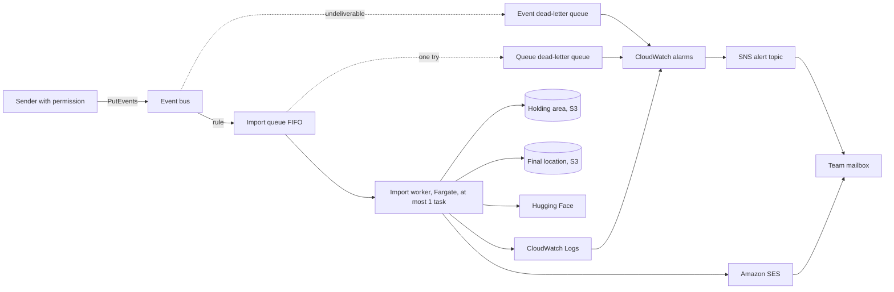

# Logical Components: u1-import-slice

This is the inventory of the logical parts that run the thin end-to-end slice, how they fail, and where each design pattern applies. It follows the answers in `nfr-design-questions.md` (Q1 to Q4) and designs for the requirements in `performance-requirements.md`, `security-requirements.md`, `scalability-requirements.md`, `reliability-requirements.md`, and `observability-requirements.md`, with the technology in `tech-stack-decisions.md`, the steps in `functional-spec.md`, and the boundaries in `contract-summary.md`. Concrete sizes, names, and settings are chosen in Infrastructure Design.

## Overview

## Component Inventory

| Component | What it is | Building blocks it hosts | Failure domain |
|-----------|-----------|--------------------------|----------------|
| Event bus and rule | A custom event bus in the common account with a resource policy that accepts events only from permitted identities of this account; one rule sends start events to the queue | Start of ImportCoordinator (contract C1) | A bus or rule fault stops new imports; nothing running is affected |
| Import queue | Amazon SQS FIFO queue with the single message group `imports`, so messages are taken one at a time and in order; the event id is the deduplication id, so a resent event is a new message; SSE-SQS encryption; a queue policy that lets only the rule send to it; message visibility is 15 minutes and the worker renews it every 5 minutes while it works, so a lost worker frees its message within 15 minutes; a message is tried once (max receive count 1); retention 4 days | The wait of requirements FR1.5 | A queue fault stops imports; events already queued are kept for up to 4 days |
| Queue dead-letter queue | A FIFO SQS queue (a FIFO queue needs a FIFO dead-letter queue) with 14-day retention that receives a message whose run crashed or timed out | Alert source for NFR4.2 and NFR4.11 | Isolated |
| Event dead-letter queue | A standard SQS queue with 14-day retention attached to the rule target; it receives an event the bus could not deliver after 24 hours of tries | Alert source for NFR4.11 | Isolated |
| Import worker | An Amazon ECS service on AWS Fargate with a maximum of 1 task and a minimum of 0; it scales to 1 when a message waits and back to 0 when the queue is empty; one task has at least 4 GiB of memory and 30 GiB of local disk. One Python program takes a message, runs one import, then asks for the next | ImportCoordinator, ModelDownloader, LeakScanner, FileCustodian, FailureNotifier | One task at a time: a crash ends one import and, with the dead-letter queue, alerts the team |
| Holding area | S3 location `holding/<importId>/` for downloaded files, plus the import record `state/<importId>.json`; lifecycle rules expire `holding/` objects after 2 days and `state/` objects after 30 days, and abort unfinished multipart uploads after 1 day | ModelDownloader, LeakScanner, FileCustodian | Isolated from the final location by prefix and by policy |
| Final location | S3 location `models/<modelName in lowercase>/<exactVersion>/` with a completion marker object written last; unfinished multipart uploads abort after 1 day | FileCustodian | Holds only complete models plus at most one unfinished model per crashed run |
| Mail identity | Amazon SES verified sender identity and a configuration set that sends bounces and complaints to the alert topic | FailureNotifier | An SES fault ends the import as removed-email-failed (BR5.5) |
| Log group | CloudWatch Logs group for the worker, 30-day retention, one JSON record per line | All building blocks | Isolated |
| Alarms and alert topic | CloudWatch alarms and an SNS topic with the team mailbox subscribed once | Operator alerts (NFR5.8) | If the alert path fails, the failure email and the logs still exist |
| Cost alarm | An AWS Budgets monthly budget sending to the alert topic | NFR5.10 | Isolated |

## Blast Radius

- A fault in the worker affects only the import it is running. The queue holds the next events.
- A bad import can write only under its own `holding/<importId>/` prefix and the one model prefix named in its event (enforced in code, BR1.3, BR5.2). The role cannot reach any other resource (NFR3.4).
- The final location is changed only after the whole scan has passed (BR4.2), and a model counts as complete only when its marker exists (Q4 A).

## Where Each Pattern Applies

| Pattern | Components |
|---------|------------|
| Queue-based serialisation | Import queue, import worker (NFR2.3) |
| Try once, then dead-letter | Import queue, queue dead-letter queue (NFR4.2) |
| Retry with backoff and a budget | Worker download client (NFR4.4, NFR4.10) |
| Idempotent clean-up | FileCustodian (NFR4.3) |
| Conditional write for a single outcome | Import record (NFR4.1) |
| Completion marker | Final location (Q4 A) |
| Lifecycle expiry as last resort | Holding area and final location (NFR4.9) |
| Allow-list logging | Worker logger (NFR5.5) |
| Least privilege, one role | Worker task role (NFR3.4) |

## Assumptions & Open Questions

- [assumption] The scaling of the worker service from 0 to 1 uses a step-scaling alarm on the queue depth, with task scale-in protection switched on while an import runs. The exact settings are chosen in Infrastructure Design.
- [assumption] One bucket with two prefixes or two buckets is decided in Infrastructure Design. The prefixes above hold for both. Two buckets make the bucket policies simpler.
- Open question: Whether EventBridge Pipes or a rule is used between the bus and the queue is a detail of Infrastructure Design; the behaviour above is the same. The rule target sets the message group id `imports` and the deduplication id from the event id.
