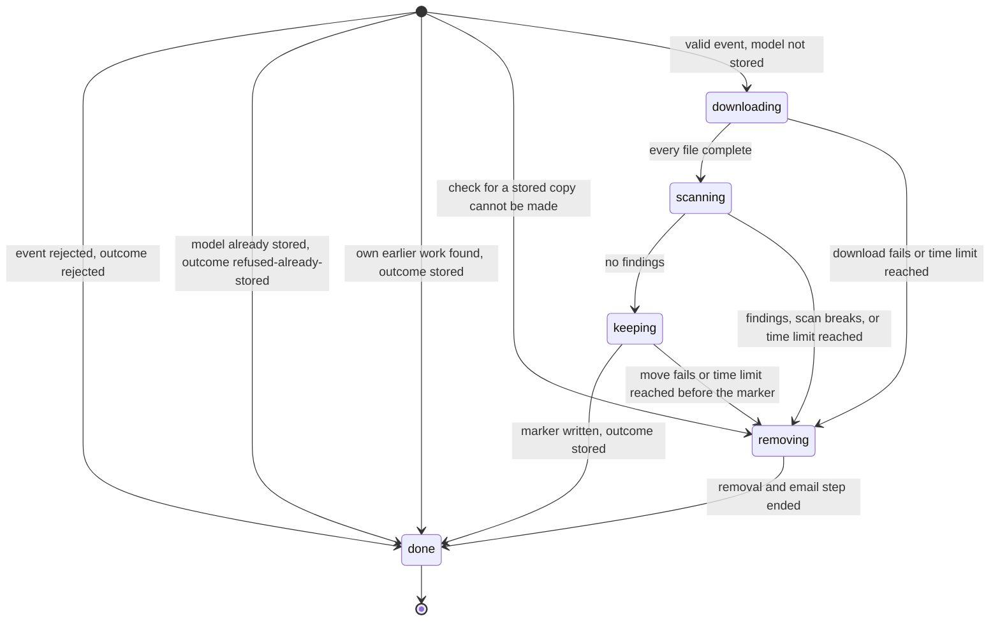
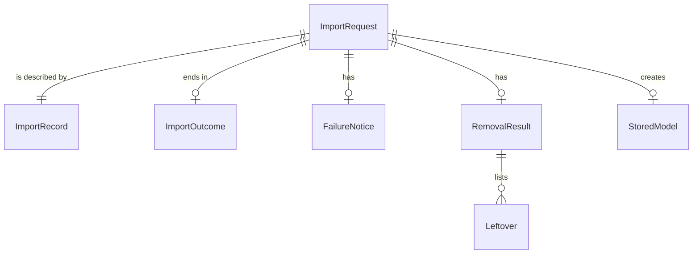

# Functional Spec: u2-import-rules

This is the behaviour that completes the thin slice, the second Bolt (one pass of building that ends in something that runs). It covers the stories (`stories.md`) US1.1 (AC1.1.2 and AC1.1.3), US2.1 (AC2.1.4), US4.1 (AC4.1.2), US5.1 (AC5.1.2 to AC5.1.5), US5.2 (AC5.2.3), and US6.1 (all), as split in `unit-of-work-story-map.md` and `unit-of-work.md`. The rules are in `rules.md` (BR6.1 to BR11.3) and the data in `entities.md`. The behaviour of u1-import-slice stays as written in its functional spec; this file adds to it and changes the points that `rules.md` lists. This file is the source of truth for the order of steps and the lifecycle of an import. The ER diagram and the rules summary below are derived views.

The building blocks are those of `components.md`. This Unit changes ImportCoordinator, FileCustodian, and FailureNotifier. ModelDownloader and LeakScanner are not changed, apart from the deadline check points that ImportCoordinator places around and inside their work (BR8.2).

## Workflow: The Front Door

Everything that arrives goes through these steps before u1's import steps run. They replace step 1 of u1's workflow.

1. A message is taken off the queue. ImportCoordinator sets `startedAt` and reads the message. IF it is not a start event (wrong source or detail type, a body that cannot be read, no eventId or eventTime), nothing more happens here and u1's dead-letter handling applies (BR6.4).
2. ImportCoordinator derives the importId from the eventId (BR10.5). IF an outcome object already exists for that importId, the message was received again: nothing is done and the message is removed from the queue, as in u1.
3. **Check the content.** The model name, the exact version, and the sender address are checked (BR1.1, BR1.3).
   - IF any field fails, the event is **rejected** (workflow below) and the steps stop.
4. ImportCoordinator sets `deadlineAt` to `startedAt` plus 6 hours (BR8.1).
5. **Check for a stored copy.** FileCustodian looks for the completion marker of `models/<modelName in lowercase>/<exactVersion>/` (BR7.1).
   - IF the marker exists and holds this import's own importId, an earlier attempt of this message stored the model and stopped before its outcome existed. The import is **finished as stored** (see the end of the Keep workflow): no email.
   - IF the marker exists and holds another importId, the event is **refused as already stored** (workflow below) and the steps stop.
   - IF the check cannot be made, it is a failed step: the ImportRecord is written with status `removing`, there is nothing to remove, and the failure workflow sends the failure email.
6. ImportCoordinator writes the ImportRecord with status `downloading`, and the import runs as in u1, with the deadline checks of BR8.2 added.

## Workflow: A Rejected Event

1. FailureNotifier writes the rejection email (BR6.3): the subject is "Model import rejected: event" followed by the eventId. The body says the request was rejected and that nothing was downloaded, names each failed field as missing or not in the expected form, and gives the eventId and eventTime. It never repeats a value from the event.
2. It sends the email to the team mailbox, and to the sender when the sender's address is present and well-formed (BR6.2). Each recipient gets its own email.
3. ImportCoordinator writes the log line `import.outcome` and then creates the outcome `rejected` (BR10.1, BR10.2) with `emailSent` and `recipientsNotReached` (BR10.3, BR10.4).
4. ImportCoordinator writes the ImportRecord once, with status `done`, the outcome, and the fields that failed in `rejectedFields` (BR11.1). It holds a model name or version only if that value passed the check.

## Workflow: A Model That Is Already Stored

1. FailureNotifier sends one email to the sender and one to the team mailbox with the model name, the exact version, the reason "this model version is already stored", and the final location (BR7.2).
2. ImportCoordinator writes the log line `import.outcome` and creates the outcome `refused-already-stored` (BR10.1, BR10.2).
3. ImportCoordinator writes the ImportRecord once, with status `done` and the outcome (BR11.1).

## Workflow: The Time Limit

The deadline is set when the import begins (BR8.1) and checked at fixed points (BR8.2).

1. ImportCoordinator compares the current time with `deadlineAt` at each of these points: before a move to a new status (not a move after the completion marker exists); before each file download starts; inside a download at every chunk written; before each retry of a download (a retry wait is cut short so it never passes the deadline); before each file is scanned; before each file is copied to the final location; and inside the copy of a file larger than 5 GiB at every part.
2. IF the time is at or after `deadlineAt`, the next piece of work is not started and the import fails with the reason "the time limit of 6 hours passed" (BR8.4).
3. Some work cannot be interrupted: one copy call of a file up to 5 GiB, the scan of one text file, and the removal and email. The scan of one text file is bounded to 5 minutes by u1. A trickling download is ended by u1's floor of 1 MB per second over 10 minutes. The target is that an import has stopped its work no later than 10 minutes after the deadline. The 7-hour watchdog of u1 is the hard backstop, one hour after the deadline.
4. The failure workflow below runs. The removal and the email are not checked against the deadline (BR8.3).
5. After the completion marker is written the model is stored and the deadline no longer applies (BR8.3, BR9.6).

## Workflow: Keep and Remove, All or Nothing

**Keep (extends u1 step 5).**

1. FileCustodian copies the files one at a time to `models/<modelName in lowercase>/<exactVersion>/`, checking the deadline before each and inside a long copy (BR9.1, BR8.2). An older unfinished file of the same name may be overwritten. The keep step no longer fails because the folder holds objects; it fails at this point only if a marker exists, and the front door has already dealt with that (BR7.1).
2. FileCustodian makes the last deadline check, then writes the marker `_COMPLETE` as the very last object. The marker holds this import's importId, the model name, the exact version, and the time (BR9.1).
3. **From the moment the marker write returns success the model is stored** (BR9.6). The holding area folder is deleted, the StoredModel is recorded, the ImportRecord is updated, and the outcome `stored` is created. No error in these steps removes the model or changes the outcome: it is logged. IF the holding area could not be fully deleted, the outcome is still `stored`, with `removalComplete` false in the outcome and the log line, so u1's alert for an incomplete removal fires. No email is sent.

**Remove (extends u1 step 6).** The removal runs for every failed import. For a failed keep step, that is a failure before the marker write returned success, it also does the following, in order (BR9.2):

1. IF the marker write was attempted, delete the marker, up to 3 tries. IF the marker still exists and holds this import's importId, stop deleting in the final location: the folder holds a complete model, because the marker is written only after every file was copied. The marker becomes the first Leftover with a note in the email, and the later steps for the holding area go on. This is the one case in which a failed import leaves files in the final location.
2. Otherwise check the folder for a marker. IF none exists, delete every object under the model version's folder, including older unfinished files from earlier imports, and count those this import did not copy. IF a marker exists that holds another importId, delete nothing there and write a log note.
3. Delete everything under `holding/<importId>/`, every incomplete upload of this import, and the temporary files on the local disk (BR5.2). A delete that fails does not stop the others (BR5.5).
4. **Prove it.** List the holding area folder, the model version's folder, the incomplete uploads, and the local disk. Every entry still there, and every delete that failed, is a Leftover. `removalComplete` is true only when there are none (BR9.3).
5. The failure email lists at most 20 Leftovers with the total, and says how many older unfinished files were also removed (BR9.4, BR9.5).

The records under `state/<importId>/` are not touched by the removal (BR11.3).

## Workflow: The End of an Import

For every import that ran, in this order:

1. The removal, if the import failed.
2. The email, if one is owed (BR5.3, BR6.2, BR7.2). If it cannot be sent, the problem is logged as `email.not_sent` with the kind of problem and the role not reached, and never an address (BR10.3). This Unit adds no retry.
3. The log line `import.outcome`, with the outcome, the reason, `removalComplete`, `emailSent`, `findingsTotal`, `olderFilesRemoved`, and the durations (BR10.2). It is written just before the outcome object, so a stop between the two cannot lose it.
4. The outcome object is created once (BR10.1). When it already existed, nothing changes, no second email is owed, and one `outcome.already_set` line is written.
5. The ImportRecord gets its final status `done`, the outcome, the reason, and, for a scan with findings, the first 200 findings with the total (BR11.1, BR11.2). The record shows `done` only after the outcome object exists.

## Lifecycle of an ImportRequest

<!-- Text fallback: An event can end at once as rejected, already stored, or finished from its own earlier work. If the stored-copy check fails it goes straight to removing. Otherwise it goes downloading, scanning, keeping, and done. From downloading, scanning, or keeping before the marker it can go to removing, and removing goes to done. After the marker is written keeping can only go to done. -->

| From | To | Trigger | Rule |
|------|----|---------|------|
| (start) | done | A start event fails the check; outcome rejected | BR6.1, BR10.1 |
| (start) | done | The marker exists with another importId; outcome refused-already-stored | BR7.1, BR10.1 |
| (start) | done | The marker exists with this import's own importId; outcome stored, no email | BR7.1, BR9.6 |
| (start) | removing | The check for a stored copy cannot be made; nothing to remove, failure email | BR7.1, BR5.1 |
| (start) | downloading | A valid event, and the model version is not stored | BR7.1, BR8.1 |
| downloading | scanning | Every file complete | BR2.5 |
| downloading | removing | The download fails, or the deadline is reached at a check point | BR5.1, BR8.2, BR8.4 |
| scanning | keeping | The scan has no finding | BR3.6 |
| scanning | removing | Findings, a failed scan, or the deadline is reached | BR3.6, BR5.1, BR8.4 |
| keeping | done | The marker is written; outcome stored, whatever happens to the clean-up that follows | BR9.1, BR9.6, BR4.3 |
| keeping | removing | The move fails, the marker write fails, or the deadline is reached before the marker | BR9.1, BR8.2, BR5.1 |
| removing | done | Removal and email step ended; outcome removed-with-email or removed-email-failed | BR9.3, BR10.1, BR10.3 |

No other transition is allowed, and `done` is final. The outcome is set once, on entry to `done`. The transitions from the start to `done` and to `removing` are new in u2: u1 allowed only the start into `downloading`. There is no transition from `keeping` to `removing` after the marker is written.

## Failure Behaviour

| What goes wrong | What the application does | Rule |
|-----------------|---------------------------|------|
| A start event lacks a field or a field is malformed | Nothing is downloaded; one email naming the fields, never the values; outcome rejected | BR6.1, BR6.2, BR6.3 |
| The sender address is missing or malformed in a rejected event | Only the team mailbox is told | BR6.2 |
| A message is not a start event | No email, no outcome; dead-letter handling of u1 alerts the team | BR6.4 |
| The model version is already stored by another import | No download; email to the sender and the team; outcome refused-already-stored | BR7.1, BR7.2 |
| The stored model is this import's own earlier work (a redriven message) | Finish as stored: remove the holding area, create the outcome stored, no email | BR7.1, BR9.6 |
| Files without a marker sit in the model version's folder | They do not count as stored; the import goes on and may overwrite them | BR7.1, BR9.1 |
| The check for a stored copy cannot be made | A failed step; nothing to remove; failure email | BR7.1, BR5.1 |
| The deadline is reached at a check point, or inside a download or a long copy | The next piece of work is not started; remove; email with the reason "the time limit of 6 hours passed" | BR8.2, BR8.4 |
| The deadline passes while the marker is being written, or after it | The model is stored and the deadline no longer applies | BR8.3, BR9.6 |
| The move fails or the marker cannot be written | Delete the marker, then every file of the model version's folder when it has no marker; check; email | BR9.1, BR9.2, BR9.3 |
| The marker cannot be deleted | The files stay with the marker as the first Leftover; the email says the final location may hold a complete copy; removalComplete is false | BR9.2, BR9.4 |
| A complete copy of another import appeared during the import | Delete nothing there; log a note; the rest of the removal goes on | BR9.2 |
| A delete fails, or the check afterwards still finds something | removalComplete is false; the email lists up to 20 leftovers and the total | BR9.3, BR9.4 |
| Older unfinished files were removed with the failed move | The email says how many | BR9.5 |
| The holding area cannot be fully deleted after the marker | The outcome is stored with removalComplete false; the leftovers are logged; no email | BR9.6 |
| The record or another bookkeeping step fails after the marker | Logged; the model stays; the outcome is stored | BR9.6 |
| The email cannot be sent | Logged as email.not_sent; outcome removed-email-failed for a failed import, or rejected or refused-already-stored for the other two, with emailSent false | BR10.3, BR10.4 |
| One of two emails is accepted and the other is not | emailSent is false and the role not reached is named; the accepted email stays sent | BR10.4 |
| The outcome already exists when it is created | Nothing changes; no second email; one log line says so | BR10.1, BR10.2 |
| A message is received again after its outcome exists | Nothing is done | BR10.1 |
| The process stops after work was done and before the outcome exists | The message is not given to a worker again by itself: it goes to the dead-letter queue and the team is alerted by u1. A person can redrive it; it starts afresh and finds its own earlier marker (stored, no email) or runs again | BR10.1, BR8.1, BR7.1 |
| The process stops between the log line and the outcome object | The same log line may appear twice after a redrive | BR10.2 |
| The process stops after the outcome of a rejected or refused event and before its record | The outcome stands; the record is missing; the log line holds the facts | BR11.1 |

## Forced-Failure Proof

User story US4.1 (AC4.1.2) and US5.1 (AC5.1.3) are proved by tests that force a failure at each point of the keep step and then check the listing. Each case below ends with the final location showing nothing from the import, and with `removalComplete` true unless the case says otherwise:

- the copy of the first file fails;
- the copy of a middle file fails;
- the copy of the last file fails;
- the marker write fails, and the marker is absent;
- the marker write reports an error but took effect, and the marker delete succeeds;
- the marker write reports an error but took effect, and the marker delete fails (the files and the marker stay; `removalComplete` false; the marker is the first Leftover);
- the deadline is reached before the third file is copied, and inside the copy of a large file;
- older unfinished files already sit in the folder and the move fails (Q3, they are removed and counted);
- a delete fails during the removal (`removalComplete` false, the leftover named in the email);
- the listing after the removal fails (`removalComplete` false);
- the holding area delete fails after the marker (the model stays, the outcome is `stored` with `removalComplete` false);
- a redriven message finds its own earlier marker (outcome `stored`, no email).

## Entity Relationships (derived from entities.md)

## Rules Summary (derived from rules.md)

| Step | Rules |
|------|-------|
| Rejected event | BR6.1, BR6.2, BR6.3, BR6.4 |
| Already stored | BR7.1, BR7.2 |
| Time limit | BR8.1, BR8.2, BR8.3, BR8.4 |
| Keep and remove | BR9.1, BR9.2, BR9.3, BR9.4, BR9.5, BR9.6 |
| Outcome and email | BR10.1, BR10.2, BR10.3, BR10.4, BR10.5 |
| Record | BR11.1, BR11.2, BR11.3 |

## Delivered by u1-import-slice

These criteria are in the stories split for this Unit but were built or settled earlier:

- **AC1.1.4 (a second event waits):** built in u1 as a queue with one message group. This Unit adds nothing for it.
- **AC1.1.1, AC2.1.1 to AC2.1.3, AC4.1.1, AC4.1.3, and AC5.2.1 and AC5.2.2:** built in u1 and unchanged here.
- **AC5.1.1 (a failure removes everything):** built in u1. This Unit adds the proof and the leftovers list (BR9.3, BR9.4).
- **AC2.1.4 (a smaller model ends inside 6 hours):** this Unit adds the deadline (BR8.1 to BR8.4). What keeps a 16 GB import fast is u1's performance targets (NFR1.2, NFR1.3, and NFR1.7 of u1).

## Corrections to Earlier Documents

Some approved documents describe u2 as it was planned before u1's design moved the wait into u1, or they are changed by the rules here. They are not edited by this stage. They need these corrections, which the person can have made together:

- `unit-of-work.md`, U2 boundaries: remove "hold a second event while an import runs" from ImportCoordinator additions.
- `unit-of-work-story-map.md`: AC1.1.4 is delivered by u1, not by u2.
- `contract-summary.md`, C4: the status `waiting` is not used; the outcomes `rejected`, `refused-already-stored`, and `removed-email-failed` are added; the completion marker `_COMPLETE` holds the importId, the model name, the exact version, and the time.
- `contract-summary.md`, C3: a rejected event has the subject "Model import rejected: event" followed by the eventId and shows no model name or version.
- u1 `functional-spec.md`, "What This Unit Does Not Do": the sentence about holding a second event while an import runs no longer describes u2.
- u1 `rules.md`: BR1.1, BR1.2, BR4.1, BR5.2, and BR5.5 are changed or restated by u2 as listed at the top of this Unit's `rules.md`.
- `bolt-plan.md`: Bolt 2's content loses the wait.

## Business Scenarios

- **Bad event:** an event with no version and a malformed sender address. Nothing is downloaded. The team mailbox gets one email that says "exactVersion: missing" and "senderEmail: not in the expected form" with the event id and time. The outcome is `rejected`. The sender, whose address was malformed, is not emailed.
- **Good event, missing sender:** an event with a valid model and version but no sender address is rejected the same way, naming only `senderEmail`.
- **Duplicate:** the model version was stored yesterday. The same event arrives. The marker is found with another importId, nothing is downloaded, the sender and the team are told it is already stored, and the outcome is `refused-already-stored`.
- **Duplicate behind the first:** two events for the same version arrive one after the other. The second waits in the queue. When its turn comes the first has stored the model, so it is refused.
- **Slow host:** the download is very slow and a long import reaches 6 hours. The download stops at its next chunk, everything is removed, and the email says "the time limit of 6 hours passed". The wait in the queue before the import did not count.
- **Failed move:** the copy of the sixth of ten files fails. The marker is not written. The removal deletes all copied files and finds a folder without a marker, so nothing is left. The email says the removal was complete.
- **Old debris:** an earlier crashed import left three files in the folder. A new import copies its files and fails at the fourth. The removal deletes all of them and the email says that 3 older unfinished files were also removed.
- **Delete fails:** one object cannot be deleted. The email says the removal was not complete and names that object, with the location cleaned.
- **Marker cannot be deleted:** the marker write reported an error but took effect, and the marker delete fails three times. The files and the marker stay. The email names the marker and says the final location may hold a complete copy. A later event for that version is refused as already stored.
- **Stop after the marker:** the process stops after the marker is written and before the outcome exists. The message goes to the dead-letter queue and the team is alerted. A person redrives it. It finds its own marker, finishes as `stored`, and sends no email.
- **Holding area clean-up fails after the marker:** the model stays stored, the outcome is `stored` with `removalComplete` false, and the team's alert for an incomplete removal fires.
- **Email service down for a failed import:** the files are removed, the log holds `email.not_sent`, and the outcome is `removed-email-failed` with `emailSent` false.
- **Email service down for a rejected event:** the outcome stays `rejected` with `emailSent` false, and the log holds `email.not_sent`.
- **Scan with findings:** the record lists the first 200 findings by cleaned file name, place, and kind, with the total, and no value.

## Assumptions & Open Questions

- [assumption] This Unit adds no retry for the email. Whatever retry the notifier of u1 has stays as it is (BR10.3).
- [assumption] Time is read from the clock of the machine that runs the import. A clock jump is not handled.
- [assumption] An event the bus delivers again after its outcome exists is dropped without a log line beyond the one u1 writes.
- [assumption] The 10-minute target after the deadline (BR8.2) is a design target, to be proved by the tests with injected clocks and by the time targets of u1.
- Open question: Alert (a) must be widened in Infrastructure Design so that a rejected or already-stored event whose email was not accepted also alerts the team, and alert (b) must fire for the outcome stored with removalComplete false (`rules.md`, open questions).
- Open question: The documents listed under Corrections to Earlier Documents are left as they are until the person asks for the changes.
