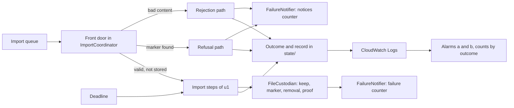

# Logical Components: u2-import-rules

This is the inventory of the logical parts this Unit adds to or changes in the application, how they fail, and where each design pattern applies. It designs for the requirements in `performance-requirements.md`, `security-requirements.md`, `scalability-requirements.md`, `reliability-requirements.md`, and `observability-requirements.md`, with the technology in `tech-stack-decisions.md`, the steps in `functional-spec.md`, and the boundaries in `contract-summary.md`. The design documents `performance-design.md`, `security-design.md`, `scalability-design.md`, `reliability-design.md`, and `observability-design.md` give the detail. The logical components of u1-import-slice (event bus and rule, FIFO import queue with its dead-letter queues, the Fargate worker with at most one task, the holding area, the final location, the mail identity, the log group, the alarms and the alert topic, the cost alarm) stay as they are. This Unit adds no AWS resource. Its only change to the stack is in two metric filters (see "Changes to the Stack").

## Overview

## Component Inventory

| Component | What it is | Building block | New or changed | Failure domain |
|-----------|-----------|----------------|----------------|----------------|
| Message classifier | The first parse of a queue message into one of three results (see "Result of the First Parse") | ImportCoordinator (the check) used by the worker (the queue loop) | New in `event.py`; `worker.py` calls it instead of `parse_start_event` | One message; no value that failed the check leaves it |
| Front door | The steps after the classifier for a start event or a rejected event: derive the importId, look for the outcome, content result, and the marker | ImportCoordinator | New steps in `coordinator.py` (`reject` and `run` both start here) | One message; a fault here ends in the dead-letter handling of u1 |
| Deadline | A value built per attempt, `started_at` + 6 hours, with `check()` | ImportCoordinator, used by ModelDownloader, LeakScanner, FileCustodian, and the retry helper | New | One import; it only ever raises `DeadlineReached` |
| Marker reader | Reads the marker of a model version and returns `own`, `other`, `missing`, or `unreadable` | FileCustodian | New in `custodian.py` | One request to the final location |
| Keep sequence | Copy each file, last deadline check, marker last, then clean-up after the marker | FileCustodian | Changed: the clean-up after the marker no longer fails the import (BR9.6) | The final location of one model version |
| Removal and proof | Delete the marker first, delete the folder when it has no marker, empty the holding folder, then list and build the Leftover list | FileCustodian | Changed: works from listings, not from memory; returns `RemovalResult` with Leftovers and `olderFilesRemoved` | The holding folder of the import and one model version's folder |
| Notice builders | Rejection email and already-stored email, built from typed inputs only | FailureNotifier | New in `notifier.py` | One email |
| Email counters | Two counter objects for the day: `emails-<date>` (30 for failure emails) and `notices-<date>` (20 for rejection and already-stored emails) | FailureNotifier with the store | Changed in `store.py` | `state/counters/` |
| Outcome and record writer | `_finish` for every path, in the order removal, email, log line, outcome object, final record | ImportCoordinator | Changed: five outcomes, new fields, log line before the object | `state/<importId>/` |
| Log allow-list | The list of fields a log record may hold | All building blocks | Changed: eight fields added | The logger |
| Alert filters | The metric filter for alert (a) and the per-outcome count filters | The stack | Changed in `infra/model_import_stack.py` | The alarms |

## Result of the First Parse

In u1 the worker parses the message with `parse_start_event`, and any failure is logged as `event_rejected` and the message is deleted. A start event with bad content therefore never reaches the coordinator. This Unit replaces that call with a classifier in `event.py` that returns one of three results, and the worker acts on each:

| Result | What it carries | What the worker does |
|--------|-----------------|----------------------|
| `StartEvent` | eventId, importId, eventTime (or none), model name, version, sender address (hidden from its text form) | As in u1: check `has_outcome` for the importId, then run the import under the heartbeat and the watchdog |
| `RejectedEvent` | eventId, importId, eventTime (or none), the names of the failed fields among `modelName`, `exactVersion`, `senderEmail`, and, only if each passed its check, the model name, the version, and the sender address | Check `has_outcome` for the importId (a repeated message ends there), then run `coordinator.reject(rejected)` under the same heartbeat and watchdog as an import, and delete the message after the outcome exists. The log is bound with `importId` and `eventId` only, plus the model name and version if they passed |
| `NotAStartEvent` | The name of the envelope field that failed (`body`, `id`, `source`, `detail-type`, or `detail`) | As in u1: log `event_rejected` with the field name, delete the message at once. No email, no outcome, no alert |

The content check collects every failed field of the detail instead of stopping at the first. `_process` takes the function to run (`run_import` or `reject_import`), so the heartbeat, the stop signal, the watchdog, and the message deletion are written once. `build_import_runner` returns both functions.

## Blast Radius

- A fault in the front door affects one message. A bad event costs its own email and outcome and nothing else, and it cannot start a download.
- A bad import can write only under `holding/<importId>/`, the one model version folder named in its event, and `state/` (enforced in code, BR1.3, BR5.2, BR9.2). The removal can delete only inside those, and in the final location only when the folder has no marker or has this import's marker.
- The role of u1 is not widened. A stolen role reaches the same three prefixes, one queue, one mail identity, and logs as before.
- The email counters make the rejection email unable to use the 30 emails kept for failed imports.

## Where Each Pattern Applies

| Pattern | Components |
|---------|------------|
| Commit marker written last | Keep sequence, marker reader (NFR4.13, NFR4.14) |
| Conditional write for a single outcome | Outcome writer (NFR4.12) |
| Cooperative deadline with check points | Deadline, downloader, retry helper, scanner, custodian (NFR1.10) |
| Idempotent clean-up with proof by listing | Removal and proof (NFR4.15, NFR4.20) |
| Typed inputs only, no free text | Notice builders (NFR3.19) |
| Two budgets for one resource | Email counters (NFR3.18) |
| Allow-list logging | Log allow-list (NFR5.16) |
| Fail closed on the unknown | Marker reader, `_COMPLETE` file check (NFR3.25) |
| Try once, then dead-letter | Import queue, unchanged (NFR4.19) |

## Changes to the Stack

- Alert (a): the metric filter is `event = import_outcome` and `emailSent = false` (NFR5.18).
- The per-outcome count filters get the values `rejected` and `refused-already-stored` (NFR5.20).
- Two value filters turn `frontDoorSeconds` and `proofSeconds` into metrics, like the other durations (NFR5.17).
- The text of the dead-letter alarm (NFR4.19 follow-up) names the record to open first.
- Everything else, including the buckets, the lifecycle rules, the role, the queue, and the topic, is unchanged. The `s3:*` and `Resource: *` check and the action-list comparison run again on the changed stack (NFR3.17).

## Assumptions & Open Questions

- [assumption] The front door is code inside the ImportCoordinator, not a separate service, because the one worker takes the message and the checks are a few requests.
- [assumption] The changes to u1's tests are small: the cases that expected a bad event to be dropped with only a log line now expect an email and an outcome.
- Open question: The owner may want an alert on `event_rejected` for messages that are not start events. None is added in this version.

## Decisions That Correct the Functional Design

- **Not-a-start-event messages (replaces a sentence of BR6.4).** BR6.4 says such a message is "left to the dead-letter handling of u1". u1's worker, as built, logs `event_rejected` with the field name and deletes the message. This design keeps what u1 built, so the sentence is replaced: the message is logged and deleted, with no email, no outcome, and no alert. The Functional Design record should be read with this decision (it is listed with the other corrections at the checkpoint).
- **A missing event time (replaces the words "or eventTime" in BR6.4).** The `time` field of the envelope is optional for a start event. The email says the time is not available when it is missing.
