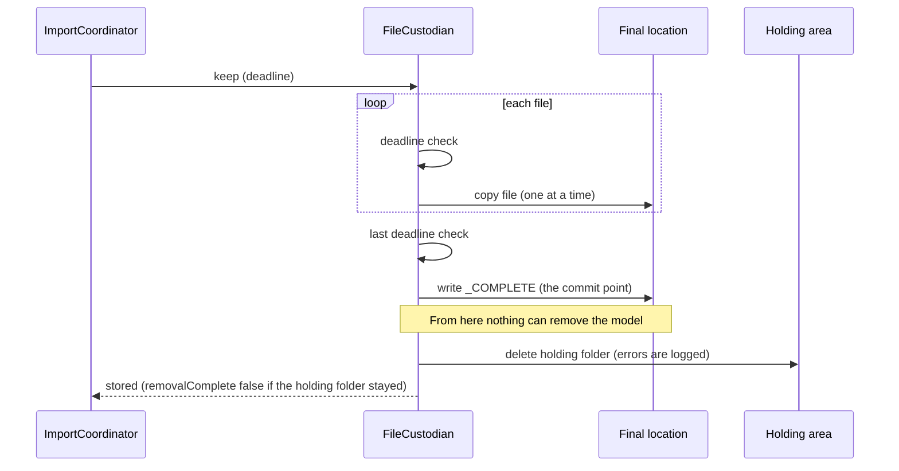

# Reliability Design: u2-import-rules

This describes how this Unit meets the requirements in `reliability-requirements.md`. It uses the components in `logical-components.md`, the lifecycle and failure table in `functional-spec.md`, the rules in `rules.md` (BR7.1, BR8.1 to BR8.4, BR9.1 to BR9.6, BR10.1 to BR10.5, BR11.1), the technology in `tech-stack-decisions.md`, and the failure behaviour in `contract-summary.md`. The other requirement documents are `performance-requirements.md`, `security-requirements.md`, `scalability-requirements.md`, and `observability-requirements.md`. The reliability design of u1-import-slice (a FIFO queue with one try and dead-letter queues, the heartbeat, the completion marker, the one-outcome conditional write, retries with a budget, lifecycle expiry) is not changed except where this document says so. The owner's decision for an unexpected stop is Q2 option A in `nfr-requirements-questions.md`.

## Design Decisions

| Requirement | Design |
|-------------|--------|
| NFR4.12 (five outcomes, one object) | `Outcome` gets the values `rejected` and `refused-already-stored`. The coordinator keeps its single exit, `_finish`, which calls `request.finish`, writes the log line, and creates the outcome object with the conditional write of u1. The new front door paths (rejected, refused, own-marker) call the same `_finish`, so no path can set an outcome in another way. The allowed transitions of `ImportRequest` get the new moves from the start to `done` and to `removing` (see the state table in `functional-spec.md`) |
| NFR4.13 (marker is the commit point) | The keep step is as u1 built it: copy each file, then write `_COMPLETE` last. The marker holds the importId, the files with sizes, the time, and now the model name and version. The front door and the keep step both treat the marker, never a file count, as the proof of a stored model |
| NFR4.14 (nothing after the marker undoes the model) | The keep step is split into two parts. Part one ends when the marker write returns success. Part two is clean-up: delete the holding folder, record the StoredModel, update the record, and set the outcome. Four things make this hold against an unexpected error, not only against a `KeepError`: (1) the custodian catches every exception inside part two, logs it, and does not raise it; (2) `keep` returns a `KeepResult` with `marker_written` (true), `holding_emptied`, and the `StoredModel`, and the coordinator sets `run.stored` from it, then sets `removalComplete` of the outcome from `holding_emptied`; (3) from `run.stored` on, an exception of any kind in the coordinator goes to `_finish` with the outcome stored and never to the removal, and `_remove_and_notify` refuses to run when `run.stored` is true; (4) as a last guard, the custodian keeps a set of imports whose marker write succeeded, and `remove` for such an import does nothing and reports complete, so even a wrong call cannot delete the marker. u1's code raises `KeepError("the holding area could not be emptied after the copy")` after the marker, and that line changes: it logs `holding_not_emptied` with the leftovers, sets `removalComplete` false, and lets the outcome be `stored` (BR9.6) |
| NFR4.15 (proof by listing) | The removal returns a `RemovalResult` with the list of `Leftover` items and the count of older files removed, replacing the count of problems that u1 returns. It lists the holding folder, the model version's folder, the incomplete uploads in both buckets, and the local work directory after the deletes. `removalComplete` is true only when the list is empty. A listing that fails becomes one Leftover that names the area that could not be checked |
| NFR4.16 (marker cannot be deleted) | The marker delete is tried 3 times with a short wait (1 second, 2 seconds). If the marker still exists and holds this import's importId, the removal keeps the files, reports the marker as the first Leftover, and continues with the holding area. This is what u1's code already does (it keeps the model files when the marker stays); the new parts are the 3 tries and the Leftover report |
| NFR4.17 (repeated message) | Order of checks at the front door: (1) the outcome object exists: delete the message and do nothing; (2) the check of the marker cannot be made (the `HEAD` or the `GET` fails with anything other than "not found"): a failed step of BR7.1, with the failure email, nothing to remove, and no refusal; (3) the marker exists and holds this importId: finish as stored (BR7.1); (4) the marker was fetched and holds another importId, or its body is not a JSON object or has no valid importId: refuse as already stored; (5) otherwise run the import. A redriven message gets a new `startedAt` and `deadlineAt` (BR8.1) and a fresh record write |
| NFR4.18 (email never stops the outcome) | The notifier returns, for each recipient role, sent or not sent with the kind of problem. The coordinator sets `emailSent` and `recipientsNotReached` from it, writes the log line `email_not_sent` for each role not reached, and sets the outcome. No exception from the notifier can reach `_finish` |
| NFR4.19 (unexpected stop) | See "Unexpected Stop" below. The automatic clean-up is not built |
| NFR4.20 (repeat safe) | Every delete of the removal is a plain delete of a key that may already be gone, which S3 reports as success. The marker delete, the prefix delete, and the upload abort treat "not found" as done (`NoSuchUpload` is already handled in u1). A test runs the removal twice and checks the same result |
| NFR4.21 (deadline never undoes a model) | The deadline is checked before the marker write and never after (see `performance-design.md`). The step that moves the import from `keeping` to `done` has no check |
| NFR4.22 (record never done without an outcome) | The end of an import is one function with the order: removal, email, log line, outcome object, final record write. The final record write happens after the outcome object exists. For a rejected or refused event no earlier record write happens |

## The Keep and Removal Sequence

<!-- Text fallback: The custodian copies each file after a deadline check, makes a last check, writes the marker, and only then deletes the holding folder. Errors after the marker are logged and do not undo the model. -->

The removal after a failed keep step runs as follows:

The final-location part (steps 1 to 3 and the final-location part of step 5) runs only when the keep step had started writing. The custodian marks an import as "writing" at the moment its pre-checks of `keep` pass and just before the first copy, and `remove` reads that mark. For a failure before that point (download, scan, the deadline before the keep step, a refused keep) nothing in the final location is listed, read, or deleted, and `olderFilesRemoved` is 0.

1. Read the marker once (a `GET`). If it holds this import's importId, delete it with 3 tries (1 and 2 seconds apart); if it still exists, stop deleting in the final location and report it as the first Leftover. If the marker write was attempted and no marker exists, there is nothing to delete. The marker is deleted only when it holds this importId.
2. A marker with another importId stays, and is not a Leftover. A marker that cannot be read stays and is a Leftover (see `security-design.md`).
3. With no marker, list `models/<name>/<version>/` and delete every key listed. This import's own keys are the ones the custodian recorded in `_written` while the keep step ran (the same in-memory set that u1 keeps; the keep step and the removal run in one process and one attempt, so it is complete). `olderFilesRemoved` is the listing minus `_written`. After a restart the message is run again from the start, so a new `_written` is built by the new attempt; a restart never needs the old set.
4. Delete `holding/<importId>/`, abort the incomplete uploads of both buckets for this import, and delete the local work directory.
5. List again as the proof (NFR4.15) and build the Leftover list.

## Unexpected Stop (NFR4.19, Q2 option A)

An unexpected stop is a crash, a lost task, a stop signal during an import, or the 7-hour watchdog. u1 handles it by the heartbeat that stops with the process, the visibility timeout that frees the message within 15 minutes, the dead-letter queue (maximum receive count 1), and the alerts (c) and (d). This Unit adds nothing to that path. The consequences are written here without softening:

- **Stop before the keep step** (download or scan): files exist only in the holding area under `holding/<importId>/`. They expire after 2 days (NFR4.9 of u1). The sender gets no email.
- **Stop during the keep step**: copied files exist under `models/<name>/<version>/` with no marker. **They do not expire.** The expiry rules of u1 cover the holding area (2 days) and unfinished uploads (1 day) only. These files are not a stored model, because there is no marker. They are removed by the next import of the same version (its overwrite, or its removal, BR9.2), or by hand. The alert (d) message tells the team to read `state/<importId>/record.json`, which holds the step, the number of files copied, and the last key copied.
- **Stop after the marker**: the model is stored and complete. No outcome exists. A person sends the message again from the dead-letter queue, and the front door finishes it as stored without an email (BR7.1).
- **Stop between the email and the outcome**: no outcome exists, and a second email is possible when the message is sent again.

This replaces the whole of NFR4.2 of u1, the sentence "nothing from the import lives on" and its target "leftovers expire within 2 days" included. NFR4.19 in `reliability-requirements.md` is read with this section. The first review of the NFR Requirements found that NFR4.19 overstated the expiry; this section is the correction. A lifecycle rule cannot expire "files without a marker" because S3 cannot test for a marker, and a rule on the whole `models/` prefix would delete stored models, so none is added.

## Failure Handling Summary

| Failure | Handling |
|---------|----------|
| The event content is bad | Reject with an email; outcome `rejected` (BR6.1) |
| The model is already stored | Refuse with an email; outcome `refused-already-stored` (BR7.1) |
| The marker was fetched and its body is not valid | Refuse as already stored; log `marker_unreadable` |
| The check of the marker fails (an S3 error other than "not found") | A failed step with the failure email; nothing to remove; no refusal |
| An unexpected error after the marker | Logged; the model stays; outcome stored; the removal is not called |
| A model file is named `_COMPLETE` | Fail before any download |
| The deadline is reached | Stop at the next check point; remove; email "the time limit of 6 hours passed" |
| The copy or the marker write fails | Delete the marker, then the folder when it has no marker; prove; email |
| The marker cannot be deleted | Keep the files; report the marker as the first Leftover |
| A delete fails | Continue; report the Leftover; removalComplete false |
| The holding area cannot be emptied after the marker | Model stays; outcome stored with removalComplete false; alert (b) |
| The email is not accepted | Log `email_not_sent`; outcome with `emailSent` false; alert (a) |
| The process stops | As in "Unexpected Stop" |

## Tests That Prove It

The forced-failure cases of `functional-spec.md` each become a test with a stand-in storage client that can fail a chosen call, with an injected clock. Added to them: the marker with another importId, the unreadable marker (front door and removal), a failing `HEAD` and a failing `GET` of the marker, the file named `_COMPLETE`, the redriven message after the marker, the redriven message with no marker, the removal run twice, a download failure and a deadline stop before the keep step with older unfinished files present (they must stay untouched and `olderFilesRemoved` must be 0), and an unexpected exception raised after the marker in each place part two can fail (the marker and the files remain, the outcome is stored, and the removal is never called).

## Changes to Code Built in u1

- `custodian.py`: `keep` returns a `KeepResult` (`stored`, `marker_written`, `holding_emptied`) and catches every exception of part two; a set of imports whose marker write succeeded, which makes `remove` a no-op for them; a "writing" mark set after the pre-checks and before the first copy; `remove` returns the `Leftover` list and `olderFilesRemoved`, reads the marker before deleting it, and deletes by listing; the marker reader with the four results.
- `coordinator.py`: `run.stored`; the generic error handler of `_keep` and of `run` go to `_finish` with the outcome stored when `run.stored` is true; `_remove_and_notify` refuses to run for a stored import; the front door steps and `reject`; `_finish` with five outcomes, the log line before the outcome object, and the record after it.
- `models.py` and `store.py`: the outcome values, the fields of the record and the outcome object, `Leftover`, `KeepResult`, and the counter that takes a name and a limit.
- `event.py` and `worker.py`: the classifier and its three results, `field(repr=False)` for the sender address, the optional `time`, and the routing of a rejected event.
- `notifier.py`: the rejection email, the already-stored email, and the per-role result.
- The tests of u1 that expected a bad event to be dropped with only a log line, and those that expected a failure after the marker to remove the model, change. Each change is named in the code summary.

## Assumptions & Open Questions

- [assumption] S3 reports success when a delete targets a key that does not exist, and the abort of an upload that does not exist returns `NoSuchUpload`, which the code already treats as done.
- [assumption] The 1 and 2 second waits between the marker delete tries are enough for a short fault; a longer fault leaves the marker as a Leftover, which is reported.
- Open question: Does the owner want the automatic clean-up for an unexpected stop later (Q2 option B)? It is left out of this version.
