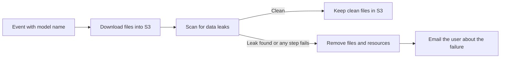

# Scope Document

## Summary

The first version imports a public open-weight model from Hugging Face into Amazon S3 in the common AWS account, scans the downloaded files for data leaks, and either keeps the clean files or removes everything and emails the user. It is due at the end of tomorrow, and that deadline governs the scope (Scope Q3, Q6, Q7).

## Inputs

- `intent-statement.md` from Intent Capture: the problem, the users, the success measures, and the first-version boundary.
- `feasibility-assessment.md` and `constraint-register.md` from Feasibility & Constraints: model scope, Bedrock limits, risks, and constraints.
- The confirmed answers Q1 to Q7 in `scope-definition-questions.md`.

## In Scope for the First Version (must have)

- Start an import when an event that carries the model name arrives. Anyone who can send the event can start an import, with no extra restriction (Scope Q4). One import runs at a time (Scope Q5).
- Download the files of a public Hugging Face model into Amazon S3 in the common AWS account. A medium model of about 140 GB is the largest case (feasibility answer Q2).
- Scan the downloaded files for data leaks: secrets, credentials, and personal data (intent statement).
- When the scan fails, or any step fails, stop, remove the downloaded files and any resources created for the import, and tell the user (intent statement).
- Email the user on every failure (intent statement).
- Keep the clean files in S3 when the scan passes, and never let a file that has not passed the scan reach the final S3 location (intent statement, Success Metrics).

## Could Have (only if the must-have capabilities are done)

- Keep a record of each import and its scan result so it can be looked at later (Scope Q1).

## Not in the First Version

- Loading the model into Amazon Bedrock (intent statement).
- Model quality testing and risky code checks. The scan covers data leaks only (intent statement).
- Not chosen as extras (Scope Q1): an email when an import succeeds, a way to check the progress of a running import, and a check of the model's architecture against Bedrock's list before downloading.

## Sequencing

Build the riskiest part first (Scope Q2): downloading and scanning a model of about 140 GB. The clean-up, the failure email, and the start event follow. The build order is in `intent-backlog.md`.

## Value Stream

An import moves through these steps from the event to one of two outcomes:

Text version:

1. An event that carries the model name starts the import.
2. The model files are downloaded into S3.
3. The files are scanned for data leaks.
4. If the scan is clean, the files stay in S3. This is the first outcome.
5. If a leak is found, or any step fails, everything downloaded and every resource created for the import is removed, and the user gets an email about the failure. This is the second outcome.

## Scope and Timeline Check

- The deadline for the whole first version is the end of tomorrow (Scope Q3, Q6). It replaces the "few days" from the feasibility answers (Scope Q7).
- All five must-have capabilities come from the original request, so none of them can be dropped. The only way to shrink the scope is to build each one in its thinnest form and leave out every extra, including the record of imports until the must-haves work.
- A single end-to-end test with a model of about 140 GB could use several hours of the time left, because the download alone is estimated at about 20 minutes to about 3 hours (feasibility assessment). Testing first with a smaller public model would leave more time. This is a suggestion for the owner to decide, not part of the scope.

## Assumptions & Open Questions

- [assumption] "End of tomorrow" is counted from the day the answer was recorded, and the owner will confirm the exact time.
- [assumption] "Anyone who can send the start event" means access is controlled outside this application in the first version.
- Open question: Should the first end-to-end test use a smaller public model than the 140 GB case to save time?
- Open question: Which public model will be imported first? This was already open in the feasibility assessment.
