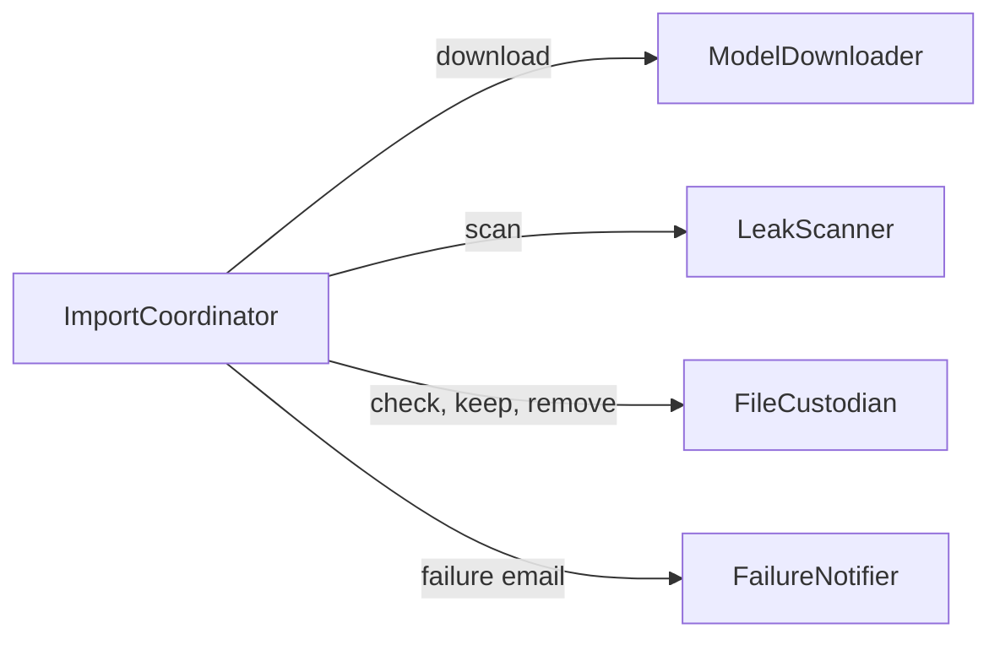

# Components

The application is split into five building blocks, the pieces of code you will write. Databases, queues, and storage are things these blocks use, not blocks themselves. How the blocks are grouped for deployment is decided in Units Generation, and the tech stack in the later design stages. This design follows `requirements.md`, `stories.md`, and `team-practices.md`.

## Component Catalogue

```yaml
components:
  - name: ImportCoordinator
    summary: Runs one import from the start event to its single outcome.
    behaviour: >
      Receives the start event and checks it has a model name, an exact version, and the
      sender's email address. Rejects a bad event before any download. Asks FileCustodian
      whether the model and version are already stored and refuses a duplicate. Runs one import
      at a time and holds a later event until the running import ends. Runs the steps in order
      and waits for each: download, scan, keep. Stops the import on any finding, any failed step,
      or when 6 hours have passed since it started, then calls the removal and the failure email.
      Makes sure each import ends in exactly one outcome and records the outcome and reason in
      the logs without secret or personal values.
    responsibilities:
      - Check the start event and refuse a bad or duplicate request
      - Run one import at a time and hold later events
      - Run the steps in order and stop on the first failure or after 6 hours
      - Own the status and the single outcome of each import
    depends_on:
      - component: ModelDownloader
        interaction: Download the files of the exact version into the holding area
        style: sync
      - component: LeakScanner
        interaction: Scan the downloaded files and return the findings
        style: sync
      - component: FileCustodian
        interaction: Check for a stored copy, keep the clean files, or remove everything
        style: sync
      - component: FailureNotifier
        interaction: Send the failure email after a failure
        style: sync
    dependents: []
    external_dependencies:
      - name: Event source
        kind: queue
        purpose: Delivers the start event that carries the model name, exact version, and sender address
      - name: Application logs
        kind: other
        purpose: Holds the outcome and reason of each import
    entities:
      - name: ImportRequest
        identifier: importId
        attributes: [importId, modelName, exactVersion, senderEmail, status, startedAt, outcome, failureReason]

  - name: ModelDownloader
    summary: Downloads the files of a public model version into the holding area.
    behaviour: >
      Downloads every file of the exact version of a public model without an account or access
      token. Writes the files only into the holding area in us-east-1, separate from the final
      location. Never treats a half-downloaded file as complete. Reports a failure if the model
      needs a login, does not exist, or a file cannot be fully downloaded.
    responsibilities:
      - Download all files of the exact version of a public model
      - Write them only to the holding area
      - Report a failure for a missing model, a login requirement, or an interrupted file
    depends_on: []
    dependents:
      - component: ImportCoordinator
        interaction: Asks for the download of one import
    external_dependencies:
      - name: Hugging Face model repository
        kind: third-party-api
        purpose: Source of the public model files
      - name: Holding area in Amazon S3
        kind: object-store
        purpose: Temporary storage for downloaded files while they are scanned
    entities:
      - name: ModelFileSet
        identifier: holdingAreaPath
        attributes: [holdingAreaPath, modelName, exactVersion, fileNames, totalSizeBytes, downloadComplete]
        references:
          - entity: ImportRequest
            owned_by: ImportCoordinator
            relationship: each ModelFileSet belongs to one ImportRequest

  - name: LeakScanner
    summary: Scans the downloaded text and settings files for secrets, credentials, and personal data.
    behaviour: >
      Reads the text and settings files for secrets, credentials, and personal data. Does not
      read weight files for content and only checks them to be the expected file type. Treats
      any finding of any kind, and any file it cannot read, as a finding. Records the file, the
      place in it, and the kind of finding, and never the value itself.
    responsibilities:
      - Scan text and settings files for leaks
      - Check weight files only for the expected file type
      - Report every finding without its value
    depends_on: []
    dependents:
      - component: ImportCoordinator
        interaction: Asks for the scan of one import
    external_dependencies:
      - name: Holding area in Amazon S3
        kind: object-store
        purpose: Source of the files to scan
    entities:
      - name: ScanFinding
        identifier: findingId
        attributes: [findingId, fileName, place, kind]
        references:
          - entity: ImportRequest
            owned_by: ImportCoordinator
            relationship: each ScanFinding belongs to one ImportRequest

  - name: FileCustodian
    summary: Keeps clean files in the final location and removes everything after a failure.
    behaviour: >
      Moves the files of a model that passed the scan from the holding area to the final
      location so that the final location shows either the whole model or nothing from this
      import. After a failure removes the holding area files, any partly moved files, and the
      temporary resources of the import, and reports anything it could not remove. Answers
      whether a model and version are already stored.
    responsibilities:
      - Move a passed model to the final location, all or nothing
      - Remove downloaded files, partly moved files, and temporary resources after a failure
      - Report what could not be removed
      - Answer whether a model and version are already stored
    depends_on: []
    dependents:
      - component: ImportCoordinator
        interaction: Asks to check, keep, or remove files
    external_dependencies:
      - name: Holding area in Amazon S3
        kind: object-store
        purpose: Source of the files to keep or remove
      - name: Final location in Amazon S3
        kind: object-store
        purpose: Where clean files are kept
    entities:
      - name: StoredModel
        identifier: storedModelKey
        attributes: [storedModelKey, modelName, exactVersion, finalLocation, storedAt]
        references:
          - entity: ImportRequest
            owned_by: ImportCoordinator
            relationship: each StoredModel was created by one ImportRequest

  - name: FailureNotifier
    summary: Sends the failure email to the sender and the team mailbox.
    behaviour: >
      Sends one email to both the person who started the import and the team mailbox with the
      model name, the exact version, the reason in plain words, and whether the removal was
      complete. Never puts a secret or personal value in the email. If the email cannot be sent,
      reports that so it can be recorded.
    responsibilities:
      - Write and send the failure email
      - Keep secret and personal values out of the email
      - Report when the email could not be sent
    depends_on: []
    dependents:
      - component: ImportCoordinator
        interaction: Asks to send the failure email for one import
    external_dependencies:
      - name: Email service
        kind: third-party-api
        purpose: Sends the failure email
    entities:
      - name: FailureNotice
        identifier: noticeId
        attributes: [noticeId, recipients, reason, removalComplete, sentAt]
        references:
          - entity: ImportRequest
            owned_by: ImportCoordinator
            relationship: each FailureNotice belongs to one ImportRequest
```

## Component Diagram



The ImportCoordinator calls each other block and waits for the answer (ADR-002). The other four blocks do not call each other.

## Component Summary

| Component | Purpose | Depends On | Dependents | Entities Owned |
|-----------|---------|------------|------------|----------------|
| ImportCoordinator | Runs one import from event to single outcome | ModelDownloader, LeakScanner, FileCustodian, FailureNotifier | None | ImportRequest |
| ModelDownloader | Downloads a public model version into the holding area | None | ImportCoordinator | ModelFileSet |
| LeakScanner | Scans text and settings files for leaks | None | ImportCoordinator | ScanFinding |
| FileCustodian | Keeps clean files, removes everything after a failure | None | ImportCoordinator | StoredModel |
| FailureNotifier | Sends the failure email | None | ImportCoordinator | FailureNotice |

## Entity Ownership

| Entity | Owning Component | Identifier | Attributes | References |
|--------|------------------|------------|------------|------------|
| ImportRequest | ImportCoordinator | importId | importId, modelName, exactVersion, senderEmail, status, startedAt, outcome, failureReason | None |
| ModelFileSet | ModelDownloader | holdingAreaPath | holdingAreaPath, modelName, exactVersion, fileNames, totalSizeBytes, downloadComplete | ImportRequest (ImportCoordinator) |
| ScanFinding | LeakScanner | findingId | findingId, fileName, place, kind | ImportRequest (ImportCoordinator) |
| StoredModel | FileCustodian | storedModelKey | storedModelKey, modelName, exactVersion, finalLocation, storedAt | ImportRequest (ImportCoordinator) |
| FailureNotice | FailureNotifier | noticeId | noticeId, recipients, reason, removalComplete, sentAt | ImportRequest (ImportCoordinator) |

## External Dependencies

| Component | Dependency | Kind | Purpose |
|-----------|------------|------|---------|
| ImportCoordinator | Event source | queue | Delivers the start event |
| ImportCoordinator | Application logs | other | Holds the outcome and reason of each import |
| ModelDownloader | Hugging Face model repository | third-party-api | Source of the public model files |
| ModelDownloader | Holding area in Amazon S3 | object-store | Temporary storage for downloaded files |
| LeakScanner | Holding area in Amazon S3 | object-store | Source of the files to scan |
| FileCustodian | Holding area in Amazon S3 | object-store | Source of the files to keep or remove |
| FileCustodian | Final location in Amazon S3 | object-store | Where clean files are kept |
| FailureNotifier | Email service | third-party-api | Sends the failure email |

## Rationale

| Component | Why it is a separate building block |
|-----------|-------------------------------------|
| ImportCoordinator | Distinct concern: it owns the order of the steps, the limits, and the single outcome of each import, and it is the only block that knows the whole flow. |
| ModelDownloader | Distinct concern and change rate: it is the only block that talks to Hugging Face, and the riskiest to build first (`intent-backlog.md`, B-1). |
| LeakScanner | Distinct concern and change rate: the rules for what counts as a leak change on their own and are still open (requirements review R-02). |
| FileCustodian | Distinct concern: removal after any failure has one owner that can be tested by forcing failures, which the rule "always remove downloaded files and temporary resources when an import fails" needs. It also owns the all-or-nothing move to the final location. |
| FailureNotifier | Distinct concern and change rate: recipients and wording change independently of the import flow, and it keeps secret and personal values out of the email. |

**Alternatives rejected:** Four blocks, with FileCustodian's work done by ImportCoordinator, makes the coordinator large and harder to test. Three blocks, which also put the failure email in the coordinator, tangle the removal and the email with the import lifecycle and make the removal rule harder to prove. Both were considered for question Q1 and are recorded in ADR-001.

## Assumptions & Open Questions

- [assumption] "Event source" is a stand-in for whatever delivers the start event. The team's choice of Amazon EventBridge (`team-practices.md`) is a design detail for later stages.
- [assumption] The holding area and the final location are two separate places, as FR2.2 and FR4.2 require. Whether they are two buckets or two paths in one bucket is a later decision.
- Open question: Does "one import at a time" mean the ImportCoordinator itself holds the waiting events, or does the event source hold them? This is settled in the infrastructure and functional design stages.
