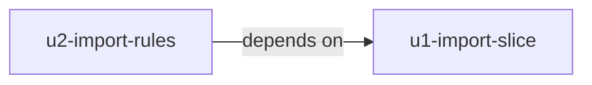

# Unit Dependencies

This describes what can depend on what. It does not choose a build order or a critical path; that is the job of Delivery Planning.

## Dependency Graph



Text version: u2-import-rules depends on u1-import-slice. u1-import-slice depends on no other unit. The graph has no cycle.

## Edge Block

```yaml
units:
  - name: u1-import-slice
    kind: service
    depends_on: []
  - name: u2-import-rules
    kind: service
    depends_on: [u1-import-slice]
```

## Integration Points

- **Shared code:** u2 changes the ImportCoordinator, FileCustodian, and FailureNotifier that u1 creates, so u2's code and tests need u1's code to build and pass.
- **Shared data:** Both units use the same import record (`ImportRequest`) owned by the ImportCoordinator, the same holding area and final location in S3, and the same logs.
- **Events and APIs:** The start event is the only way in. Both units use the same start event; u2 adds the checks that reject some events.

## Parallel Development Opportunities

None. u2 needs u1's code to build and pass, so only one valid ordering exists.

## First Integrated Slice

u1-import-slice is the first unit in the resolved order. It can run on its own, end to end, for the normal paths: a clean model is kept, and a finding or a failed step removes everything and sends the email. That makes it the integrated slice that the team's thin-slice-first practice asks for (`team-practices.md`, Walking Skeleton). u2 does not need to exist for u1 to run.
